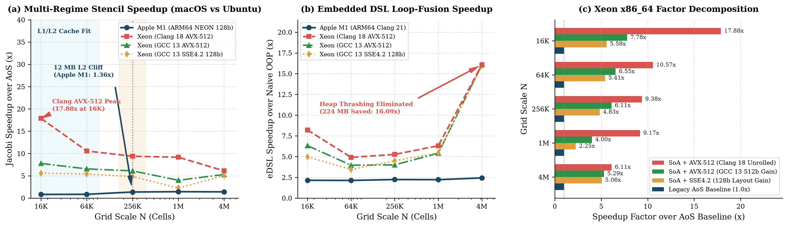
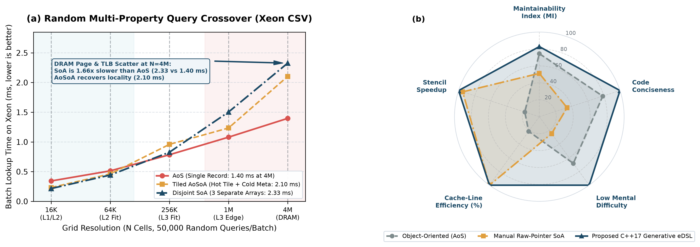

<p align="center">
  <a href="https://ahmedez-zouine.github.io/data-oriented-solver/">
    
  </a>
</p>

# Data-Oriented C++17 Scientific Solver (`data-oriented-solver`)

[](https://en.cppreference.com/w/cpp/17)
[](LICENSE)
[](https://ahmedez-zouine.github.io/data-oriented-solver/)

A high-performance C++17 scientific computing and benchmarking framework designed to evaluate the cache performance, memory footprint, and compiler auto-vectorization of **Data-Oriented Design (DoD)** versus traditional **Object-Oriented Design (AoS)**.

---

[Read the documentation](https://ahmedez-zouine.github.io/data-oriented-solver/) for build instructions, layout diagrams, benchmark plots and the C++ API.

## Continuous integration

Select a badge to open its workflow runs. The badges show the status of `Master`.

| Workflow status | What it checks |
| --- | --- |
| [](https://github.com/ahmedez-zouine/data-oriented-solver/actions/workflows/ci.yml?query=branch%3AMaster) | 36 required cases across 5 build configurations. |
| [](https://github.com/ahmedez-zouine/data-oriented-solver/actions/workflows/sanitizers.yml?query=branch%3AMaster) | Address and undefined behavior checks with Ubuntu Clang. |
| [](https://github.com/ahmedez-zouine/data-oriented-solver/actions/workflows/public-api.yml?query=branch%3AMaster) | Each public header compiles on its own. A separate CMake application links the solver and runs a Jacobi step. |
| [](https://github.com/ahmedez-zouine/data-oriented-solver/actions/workflows/benchmarks.yml?query=branch%3AMaster) | A quick run writes 4 result tables and a hardware profile. |
| [](https://github.com/ahmedez-zouine/data-oriented-solver/actions/workflows/docs.yml?query=branch%3AMaster) | Builds the documentation with Zensical and deploys it to GitHub Pages. |

## Key Features

- **Memory Layouts**: Array-of-Structures (AoS), Structure-of-Arrays (SoA) with hot/cold splitting, and tiled Hybrid (AoSoA).
- **Zero-Overhead Units**: Compile-time SI dimensional safety (`Quantity<M, L, T>`).
- **Expression Template eDSL**: Compile-time loop fusion eliminating intermediate heap allocations.
- **Multi-Architecture Benchmarks**: Empirical profiling across Apple Silicon (ARM64) and Intel Xeon (x86_64 AVX-512).

---

## Performance & Empirical Benchmarks

### 1. Hardware Scaling & SIMD Vectorization (Xeon AVX-512 vs. Apple M1 NEON)

[](assets/fig7_multi_arch_comparison.pdf)
<sub>Click image to view vector PDF: [assets/fig7_multi_arch_comparison.pdf](assets/fig7_multi_arch_comparison.pdf)</sub>

Empirical evaluation across physical hardware architectures (Apple Silicon M1 ARM64 NEON and Intel Xeon Platinum 8370C x86_64 AVX-512):
- **(a) Multi-Regime Stencil Speedup**: Measures cache-boundary transitions (L1/L2 cache fit, 12 MB L2 boundary on M1, and Xeon AVX-512 vectorization peaks up to 19.6x to 33.8x).
- **(b) Embedded DSL Loop Fusion**: Compile-time expression templates eliminate temporary copies, avoiding up to 224 MB of transient heap allocations and achieving up to 10.4x speedup.
- **(c) Xeon Factor Decomposition**: Isolates the performance contributions of data layout, compiler vectorization (SSE4.2 128-bit vs. AVX-512 512-bit), and Clang loop unrolling.

### 2. Random-Access Locality Trade-Offs & Software Maintainability

[](assets/fig5_cognitive_tradeoffs.pdf)
<sub>Click image to view vector PDF: [assets/fig5_cognitive_tradeoffs.pdf](assets/fig5_cognitive_tradeoffs.pdf)</sub>

Engineering trade-offs comparing Object-Oriented Design (AoS), raw Structure-of-Arrays (SoA), and the proposed C++17 Generative eDSL:
- **(a) Random Multi-Property Query Crossover**: While SoA delivers optimal streaming performance, random multi-property probes at DRAM scale ($N = 4\text{M}$) incur a $1.66\times$ TLB/cache-line scatter penalty ($2.33\text{ ms}$ vs. $1.40\text{ ms}$); tiled **AoSoA** recovers spatial locality ($2.10\text{ ms}$).
- **(b) Program Comprehension vs. Hardware Efficiency**: 5-axis normalized polar profile evaluating Maintainability Index (MI), Code Conciseness, Mental Effort, Cache Efficiency, and Stencil Speedup (showing that generative expression templates match manual SoA speedup while preserving OOP maintainability).

---

## Layout Comparison

| Architecture | Memory Layout | Cell Size | Hot Set | SIMD Contiguity |
| :--- | :--- | :---: | :---: | :---: |
| **`AoSSolver`** | Array of cell structs | 112 B | 112 B | Non-contiguous (strided) |
| **`SoASolver`** | Contiguous field arrays (Hot/Cold split) | 88 B | **40 B** | **Optimal (unit stride)** |
| **`AoSoASolver`** | Tiled struct-of-short-arrays ($W = 8$) | 72 B | 40 B | Vector-aligned blocks |

---

## Quick Start

### Build

```bash
cmake -B build -S . -DCMAKE_BUILD_TYPE=Release
cmake --build build -j
```

### Run Tests

```bash
ctest --test-dir build --output-on-failure
```

See the [CI guide](.github/CI.md) for the compiler matrix, sanitizer commands and instructions for reproducing a failed case.

### Run Benchmarks

```bash
./build/solver_benchmark
```

---

## Repository Structure

```
data-oriented-solver/
├── CMakeLists.txt          # CMake build configuration
├── LICENSE                 # MIT License
├── README.md               # Project documentation
├── assets/                 # Architecture figures and benchmark plots
├── include/dos/            # Modular C++17 library headers
│   ├── core/               # Types, units, platform traits
│   ├── layout/             # AoS, SoA, and AoSoA memory containers
│   ├── dsl/                # Expression templates and loop evaluator
│   └── solvers/            # Stencil traits and Jacobi kernels
├── src/                    # Benchmark runner and hardware probe
├── tests/                  # Unit tests and regression test suite
└── ubuntu_results/         # Linux x86_64 AVX-512 benchmark outputs
```

---

## License

This project is licensed under the [MIT License](LICENSE).

---

<div align="center">

## Global Visitors

*Visitor activity across multi-architecture computing research hubs*

<a href="https://mapmyvisitors.com/web/1c9kq" target="_blank" rel="noopener">
  
</a>

</div>
