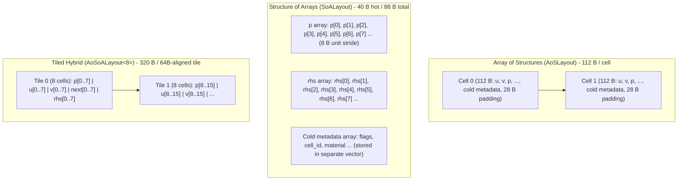

# Memory Layout Architecture

In high-performance scientific computing, memory layout dictates computational efficiency. Modern CPUs do not fetch individual floats from DRAM; they fetch contiguous **64-byte cache lines**. How simulation cell properties are arranged in physical memory determines whether each 64-byte fetch supplies useful numbers to vector registers or wastes memory bus bandwidth on irrelevant metadata and alignment padding.



## The 64-Byte Cache Line Reality

A standard 64-byte CPU cache line holds exactly **8 `double` values** (each 8 bytes). When updating a single field (such as pressure $p$) across cells during a stencil relaxation sweep:

- **Structure of Arrays (`SoA`):** Consecutive cell pressures sit side by side in memory (8 B stride). A single 64 B cache line fetch brings in **8 consecutive active pressures**, allowing an AVX-512 vector register (512 bits = 8 doubles) or four ARM64 NEON registers (128 bits = 2 doubles each) to execute with 100% cache line utilization and zero wasted bytes.
- **Array of Structures (`AoS`):** Consecutive cell pressures are separated by 112 bytes. To read two consecutive cell pressures, the CPU must fetch **two separate 64-byte cache lines** (128 bytes total), pulling along velocities, material flags, boundary tags, and padding gaps that the pressure kernel never touches.
- **Tiled Hybrid (`AoSoA<8>`):** Groups 8 cells into a tile. Within each tile, 8 consecutive pressure values form a contiguous 64-byte vector-aligned block, preserving vectorization while clustering the hot fields of those 8 cells within 320 bytes to retain multi-field locality.

## Accessing a Single Pressure Value

=== "AoS (Strided Member Access)"

    ```cpp
    dos::AoSLayout cells(1024);
    // Access cell 9: jumps to 9 * 112 bytes
    cells.p(9) = 1.5;
    ```

=== "SoA (Contiguous Unit-Stride Access)"

    ```cpp
    dos::SoALayout cells(1024);
    // Access cell 9: direct array offset p_data()[9]
    cells.p_data()[9] = 1.5;
    ```

=== "AoSoA<8> (Tile + Lane Access)"

    ```cpp
    dos::AoSoALayout<8> cells(1024);
    // Cell 9 -> tile 9/8 = 1, lane 9%8 = 1
    cells.tile(1).p[1] = 1.5;
    ```

## Layout Comparison Matrix

| Layout Design | Total Bytes / Cell | Hot Working Set | Stencil Stride | SIMD Vectorization |
| :--- | :---: | :---: | :--- | :--- |
| [**Array of Structures (AoS)**](aos.md) | 112 B | 112 B | 112 B strided | Requires vector gathers or unrolling |
| [**Structure of Arrays (SoA)**](soa.md) | 88 B | **40 B** (-64.3%) | **8 B unit stride** | **Direct aligned vector loads (AVX-512 / NEON)** |
| [**Tiled Hybrid (AoSoA<8>)**](aosoa.md) | 72 B | **40 B** (-64.3%) | 8-double block | 64 B aligned tile loads |

## Next Steps

Explore the architectural details and trade-offs of each container layout:

- [Array of Structures (`AoSLayout`)](aos.md): Traditional OOP object layout, alignment padding analysis, and point-query performance.
- [Structure of Arrays (`SoALayout`)](soa.md): Hot/cold partitioning, cache line saturation, and vectorization without gathers.
- [Tiled Hybrid (`AoSoALayout<8>`)](aosoa.md): Tile size selection, AVX-512 alignment, and spatial locality preservation.
