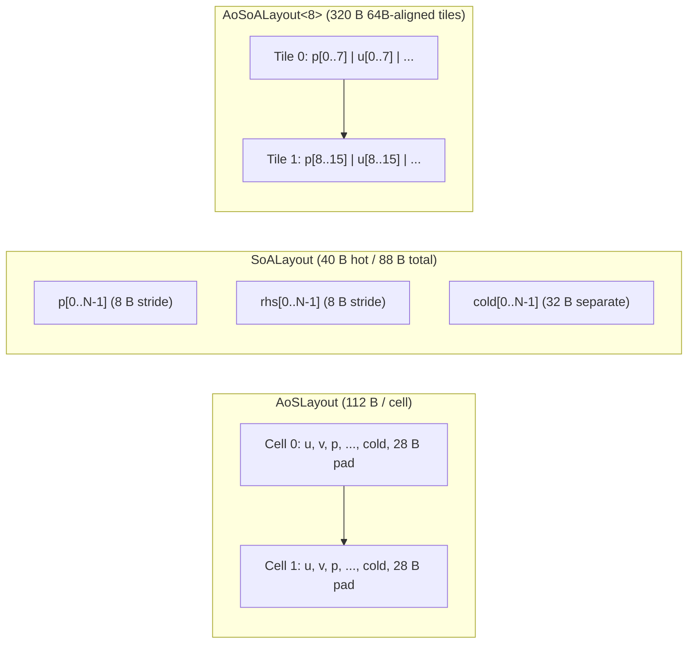

# Memory Layout Architecture

For $N$ grid cells, the container layout controls the byte stride between consecutive field values and determines which cold metadata rides along in each cache line. The byte counts below measure field storage and exclude container wrapper overhead.



## Accessing a Single Pressure Value

=== "AoS"

    ```cpp
    dos::AoSLayout cells(64);
    cells.p(9) = 1.5;
    ```

=== "SoA"

    ```cpp
    dos::SoALayout cells(64);
    cells.p_data()[9] = 1.5;
    ```

=== "AoSoA (W = 8)"

    ```cpp
    dos::AoSoALayout<8> cells(64);
    cells.tile(1).p[1] = 1.5; // Cell 9 -> tile 1, lane 1
    ```

## Stride & Footprint Summary

| Layout | Total Footprint | Five Hot Fields | Pressure Access Pattern |
| :--- | :---: | :---: | :--- |
| [**AoS**](aos.md) | 112 B | Spread across record | Advance 112 B per cell |
| [**SoA**](soa.md) | 88 B | **40 B** | Advance 8 B per `double` (unit stride) |
| [**AoSoA ($W=8$)**](aosoa.md) | 72 B (full tile) | **40 B** | 8 consecutive doubles per tile; 320 B between tiles |
