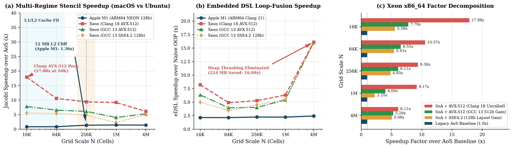

# Multi-Architecture Scaling

Empirical measurements compare Jacobi stencil sweeps and expression-template evaluation across **Apple Silicon M1 (ARM64 128-bit NEON)** and **Intel Xeon Platinum 8370C (x86_64 AVX-512)** using Clang 18 and GCC 13.

  
  

    Multi-regime stencil speedups, eDSL loop-fusion scaling, and Xeon SIMD factor decomposition.
    <a href="../../assets/fig7_multi_arch_comparison.pdf">Open high-resolution vector PDF &rarr;</a>
  

## Cache Hierarchy & Vectorization Breakdown

Grid scales span five sizes from $16{,}384$ to $4{,}194{,}304$ cells:

- **L1/L2 Cache Fit (16K cells):** Clang 18 with AVX-512 reaches **17.88x** over AoS, while GCC 13 reaches **7.78x** with AVX-512 and **5.58x** with SSE4.2 (128-bit).
- **Apple M1 12 MB L2 Transition (256K cells):** At $262{,}144$ cells, the five SoA hot fields occupy **10 MiB** (fitting inside L2), whereas AoS records occupy **28 MiB** (spilling to DRAM), producing a **1.36x** speedup peak on M1.
- **DRAM Bandwidth Regime (4M cells):** Xeon Clang 18 sustains **6.11x** and GCC 13 sustains **5.29x** over AoS.

| Intel Xeon Configuration (SoA Jacobi over AoS) | 16,384 cells | 4,194,304 cells |
| :--- | :---: | :---: |
| **Clang 18 (AVX-512, unrolled)** | **17.88x** | **6.11x** |
| **GCC 13 (AVX-512, 512-bit)** | **7.78x** | **5.29x** |
| **GCC 13 (SSE4.2, 128-bit layout baseline)** | **5.58x** | **5.06x** |

In Panel (b), the **16.09x** peak eDSL speedup at 4M cells compares fused expression evaluation against eager OOP field operators that allocate 224 MiB of temporary heap buffers. See [Expression Template eDSL](../abstractions/edsl.md) for details.
