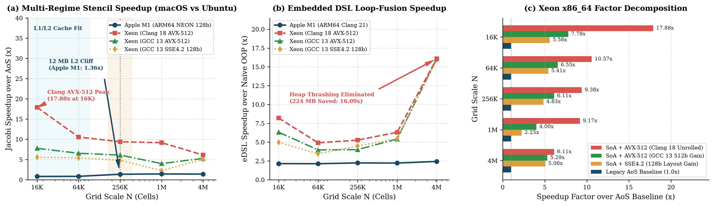

# Multi-architecture scaling

## Streaming sweeps

The first plot compares Jacobi and expression evaluation on an Apple M1 with 128-bit NEON and an Intel Xeon with AVX-512. Read each speedup against the baseline named on its axis. In panel C, at 16K cells, the Xeon Jacobi ratios are 17.88x with Clang 18 and 7.78x with GCC 13 using AVX-512. At 4M cells the same series reach 6.11x and 5.29x. Grid size and compiler both matter when choosing a layout.

[Open the scaling plots as a vector PDF](/assets/fig7_multi_arch_comparison.pdf)

## Read the cache and SIMD comparisons

The five sizes range from 16,384 to 4,194,304 cells. Panel A marks the Apple M1's 12 MB L2 transition and labels a 1.36x Jacobi speedup there. At 262,144 cells, the five SoA hot fields occupy 10 MiB while the AoS records occupy 28 MiB. These footprints help interpret the transition. Cache residency also depends on the fields and rows the sweep actually touches.

| Xeon Jacobi speedup over AoS | 16,384 cells | 4,194,304 cells |
| --- | ---: | ---: |
| Clang 18, AVX-512 | 17.88x | 6.11x |
| GCC 13, AVX-512 | 7.78x | 5.29x |
| GCC 13, SSE4.2 (128-bit) | 5.58x | 5.06x |

The two GCC rows compare vector configurations within one compiler. Comparing the Clang and GCC rows also changes the compiler and its loop transformations. In panel B, the 16.09x annotation uses eager field operators as its denominator. [Expression and allocation model](/abstractions/edsl/)
