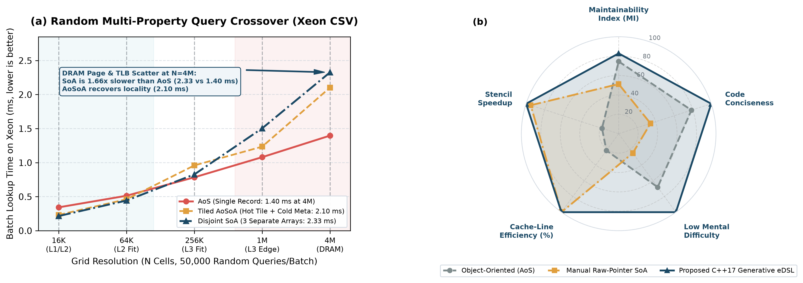

# Locality Trade-Offs & Software Quality

While SoA delivers peak throughput on contiguous streaming stencils, engineering layout decisions must also account for scattered multi-property lookups and long-term code maintainability.

  
  

    Random multi-property lookup batch times across grid scales (a) and 5-axis normalized implementation profile (b).
    <a href="../../assets/fig5_cognitive_tradeoffs.pdf">Open high-resolution vector PDF &rarr;</a>
  

## Scattered Random-Access Crossover

The Xeon query benchmark performs **50,000 random multi-property probes** per batch reading velocity, pressure, and metadata at scattered indices:

- **L1/L2 Cache Scale (16K cells):** SoA (`0.21 ms`) edges out AoS (`0.35 ms`) because the entire working set stays cache-resident.
- **DRAM Scale (4M cells):** SoA (`2.33 ms`) becomes **1.66x slower** than AoS (`1.40 ms`) because each scattered lookup touches three disjoint virtual memory pages.
- **Hybrid Recovery:** Tiled **AoSoA** (`2.10 ms`) recovers partial spatial locality while preserving vector-aligned tiles for stencil sweeps.

## Five-Axis Implementation Profile

Panel (b) compares traditional OOP AoS, manual raw-pointer SoA, and the C++17 Generative eDSL across five normalized axes (outer radius = optimal):

| Radar Axis | Interpretation (Larger Radius = Better) |
| :--- | :--- |
| **Maintainability Index (MI)** | Higher composite maintainability score |
| **Code Conciseness** | Fewer lines of boilerplate per kernel |
| **Low Mental Difficulty** | Lower estimated cognitive complexity |
| **Cache-Line Efficiency (%)** | Higher useful byte utilization per 64 B fetch |
| **Stencil Speedup** | Faster streaming throughput relative to AoS |
